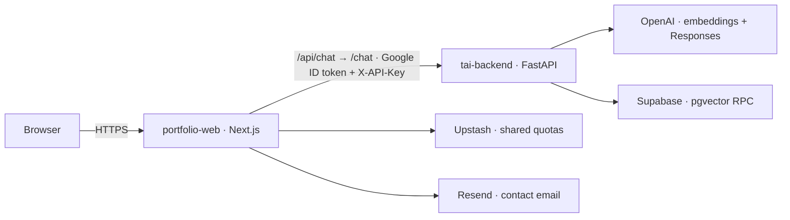

# Google Cloud Run production deployment

Prepared 20 October 2026. This is a manual runbook, not an executed deployment.
Production URL: **not deployed / not verified**. No cloud resources, billing settings,
service-account keys, GitHub triggers, or deployments are created by these files.

## 1. Architecture and release gates

One project, region `europe-west1`, two services:

| Service | Access | Runtime identity |
| --- | --- | --- |
| `portfolio-web` | Public HTTPS; Next.js pages and `/api/chat`, `/api/contact` | `portfolio-web-sa` |
| `tai-backend` | IAM authentication required; additionally checks `X-API-Key` | `tai-backend-sa` |



The backend is **IAM-private, not VPC-only**. Use ingress `all` with IAM checks
enabled and no public invoker grant. Direct unauthenticated internet requests are
rejected by Cloud Run. Same-project services do not automatically satisfy internal
ingress restrictions without network configuration. No VPC connector, load balancer,
NAT, Cloud SQL, or always-on worker is needed. Only the web service account receives
Invoker on this backend; audit inherited project-level Invoker grants too.

The Next.js server detects platform-provided `K_SERVICE`, uses `BACKEND_URL`, and
obtains an audience-bound ID token with `google-auth-library` and Application
Default Credentials. The attached web identity supplies ADC through Google's
metadata service. It forwards the credential as `X-Serverless-Authorization` and
retains `X-API-Key`. Tokens are never returned to the browser. Token acquisition is
bounded to five seconds; failures return a generic 503 with no unauthenticated retry.
The library caches/refreshes tokens. No service-account JSON file is needed.

Release gates before public use:

- Configure both billing controls below and verify provider-side budgets.
- Confirm Supabase migrations and index exist; verify the configured model is available.
- Prove the proposed 512 MiB memory limit under representative requests. This has
  **not** been established by Windows unit tests. Do not treat the flags below as
  a memory sufficiency claim. If it fails, reassess memory and budget before launch.
- Run the IAM, streaming, metadata, quotas, and contact checks below.
- Accept shared visitor quotas initially, or verify the proxy chain before enabling
  per-IP quotas. Do not guess a trusted proxy-hop count.

References: [service authentication](https://docs.cloud.google.com/run/docs/authenticating/service-to-service),
[ingress](https://docs.cloud.google.com/run/docs/securing/ingress),
[container contract](https://docs.cloud.google.com/run/docs/container-contract).

## 2. Account, project, billing, and cost controls

Sign in to Google Cloud Console, create/select a billing account, and create a
dedicated project. Link billing manually. Use the same project in Cloud Shell.
Choose a globally unique project ID; do not use the placeholder literally.

In **Billing → Budgets & alerts**, manually create:

1. **Spend cap**: monthly **USD 2.50**, scoped to this one project and the **Cloud Run**
   service category (`152E-C115-5142`). Confirm its state is Configured.
2. **Alerts-only budget**: monthly **USD 3.00**, this project, **all services**, with
   email alerts at 50%, 80%, and 100%. Confirm notification recipients.

If spend-cap controls are unavailable for the billing account, stop and resolve
eligibility/permissions before deployment. No application variable configures them.

Spend caps use gross estimated list-price usage, before savings/credits. The billed
amount can therefore be lower. Enforcement is not instant: in-flight work and
overages can still incur charges. A cap pauses new usage and resets next month;
manually lifting it resumes spending. It is not a guaranteed final invoice ceiling.
[Spend cap documentation](https://docs.cloud.google.com/billing/docs/how-to/budgets-spend-caps).

The Cloud Run category covers both services, not the entire application bill.
Cloud Build, Artifact Registry image storage, source storage, Secret Manager,
logging, network transfer, and external OpenAI/Supabase/Upstash/Resend usage require
separate monitoring. Alerts-only budgets do not stop spending. Keep external
services within their actual plan limits and manually configured OpenAI limits.
The **USD 5/month total is a target, not a guarantee**. Keep few image versions,
review build/source-storage retention, and avoid body/header/token logging.

## 3. Cloud Shell preparation and permissions

Commands are Bash for Cloud Shell, checked against the current gcloud reference.
They have not been executed against a Google project. Run each section deliberately;
do not paste the entire runbook as an unattended script.

After authorizing cloud setup:

```bash
export PROJECT_ID='REPLACE_WITH_PROJECT_ID'
export REGION='europe-west1'
gcloud config set project "$PROJECT_ID"
gcloud services enable run.googleapis.com cloudbuild.googleapis.com \
  artifactregistry.googleapis.com secretmanager.googleapis.com iam.googleapis.com
git clone https://github.com/TudorIacob/tudor-iacob-portfolio.git
cd tudor-iacob-portfolio
git switch main
git pull --ff-only
```

Before setup, confirm the checkout includes the reviewed Cloud Run preparation
commit and the Dockerfiles described below.

The human setup administrator needs permission to create identities, secrets,
budgets, and IAM bindings. For ongoing source deployment, use Cloud Run Source
Developer and Service Usage Consumer on the project, plus Service Account User on
the runtime/build identities. Changing service IAM policies requires additional
permission (for example Cloud Run Admin during setup); do not give it to runtime
identities. Keep existing Google-managed service-agent roles intact.

Create two runtime accounts. A separate build account has no runtime secrets:

```bash
gcloud iam service-accounts create portfolio-web-sa
gcloud iam service-accounts create tai-backend-sa
gcloud iam service-accounts create portfolio-build-sa
export WEB_SA="portfolio-web-sa@$PROJECT_ID.iam.gserviceaccount.com"
export API_SA="tai-backend-sa@$PROJECT_ID.iam.gserviceaccount.com"
export BUILD_SA="portfolio-build-sa@$PROJECT_ID.iam.gserviceaccount.com"
gcloud projects add-iam-policy-binding "$PROJECT_ID" \
  --member="serviceAccount:$BUILD_SA" --role=roles/run.builder
```

`portfolio-build-sa` is a build-only identity, not a third running service.
Do not grant Editor, Owner, or project-wide Secret Accessor to either runtime
account. Token Creator is not needed by the web service to use its own attached
identity. Do not create/download keys or set `GOOGLE_APPLICATION_CREDENTIALS`.
See [source build identities](https://docs.cloud.google.com/run/docs/configuring/services/build-service-account).

If the deployer does not already have these permissions, an administrator can
grant the scoped roles below. `DEPLOYER_EMAIL` is the human Cloud Shell account:

```bash
export DEPLOYER_EMAIL='REPLACE_WITH_DEPLOYER_EMAIL'
for role in roles/run.sourceDeveloper roles/serviceusage.serviceUsageConsumer; do
  gcloud projects add-iam-policy-binding "$PROJECT_ID" \
    --member="user:$DEPLOYER_EMAIL" --role="$role"
done
for account in "$WEB_SA" "$API_SA" "$BUILD_SA"; do
  gcloud iam service-accounts add-iam-policy-binding "$account" \
    --member="user:$DEPLOYER_EMAIL" --role=roles/iam.serviceAccountUser
done
```

Service IAM policy changes and initial secret setup still require the administrator
permissions described above. Do not add those permissions to runtime identities.

## 4. Secrets and least privilege

Create these five Secret Manager secrets in this project; add their initial values
through the Console's secret-version editor. Paste existing credentials privately.
Do not put values into shell commands, committed files, build arguments, or logs.
Regional replication is scoped here to `europe-west1`.

```bash
for secret in LLM_API_KEY SUPABASE_SECRET_KEY BACKEND_API_KEY \
  RESEND_API_KEY UPSTASH_REDIS_REST_TOKEN; do
  gcloud secrets create "$secret" --replication-policy=user-managed \
    --locations="$REGION"
done
```

The shared `BACKEND_API_KEY` is mounted in
both services rather than duplicated. Add version `1` of each via the Console.
If they already exist, inspect them and use the intended numeric version instead
of recreating or overwriting them.

```bash
for secret in BACKEND_API_KEY RESEND_API_KEY UPSTASH_REDIS_REST_TOKEN; do
  gcloud secrets add-iam-policy-binding "$secret" \
    --member="serviceAccount:$WEB_SA" --role=roles/secretmanager.secretAccessor
done
for secret in BACKEND_API_KEY LLM_API_KEY SUPABASE_SECRET_KEY; do
  gcloud secrets add-iam-policy-binding "$secret" \
    --member="serviceAccount:$API_SA" --role=roles/secretmanager.secretAccessor
done
```

Use numeric versions for deterministic releases and rollback. Rotation means adding
a new version and deploying revisions that reference it; keep the previous version
enabled until its rollback window ends. Never expose any secret with `NEXT_PUBLIC_`.

## 5. Environment matrix

### Next.js / portfolio-web

| Variable | Classification | Setting |
| --- | --- | --- |
| `SITE_URL` | Plain runtime | Actual public HTTPS origin; no trailing slash |
| `BACKEND_URL` | Plain runtime | Canonical backend `https://…run.app` origin; no path/query |
| `BACKEND_API_KEY` | Secret Manager | Shared with backend |
| `RESEND_API_KEY` | Secret Manager | Resend credential |
| `UPSTASH_REDIS_REST_TOKEN` | Secret Manager | Redis credential |
| `UPSTASH_REDIS_REST_URL` | Plain runtime | Existing HTTPS Redis endpoint |
| `CONTACT_EMAIL_TO` | Plain runtime | Intended recipient |
| `CONTACT_EMAIL_FROM` | Plain runtime | Verified Resend sender |
| `TAI_RATE_LIMIT_PER_MINUTE` | Plain runtime | `15` |
| `TAI_RATE_LIMIT_PER_DAY` | Plain runtime | `100` |
| `CLOUD_RUN_TRUSTED_PROXY_HOPS` | Plain runtime | `0` until proxy chain is verified |
| `NODE_ENV` | Image runtime default | `production` |
| `PORT` | Cloud Run injected | `8080` in these commands; honored by server |
| `K_SERVICE` | Cloud Run injected | Do not set manually |
| `NEXT_TELEMETRY_DISABLED` | Build + image runtime | `1`; not a secret |
| `TAI_BACKEND_URL`, `VERCEL` | Vercel-only | Leave unset on Cloud Run |
| `TRUSTED_CLIENT_IP_HEADER` | Other hosting only | Leave unset on Cloud Run |

No application credentials or site URL are required at build time. Root layout,
robots, sitemap, and inherited project-page metadata are dynamically rendered so
`SITE_URL` can be corrected without rebuilding. Local builds default to localhost,
which is deliberately non-indexable. Restart/revise the service after URL changes.

### FastAPI / tai-backend

| Variable | Classification | Setting |
| --- | --- | --- |
| `MODE` | Plain runtime | `live`; Cloud Run refuses demo startup |
| `BACKEND_API_KEY` | Secret Manager | Same version/value as web |
| `LLM_API_KEY` | Secret Manager | Existing provider credential |
| `SUPABASE_SECRET_KEY` | Secret Manager | Modern `sb_secret_` key |
| `LLM_BASE_URL` | Plain runtime | `https://api.openai.com/v1` |
| `LLM_MODEL` | Plain runtime | `gpt-6-luna` (existing setting) |
| `LLM_REASONING_EFFORT` | Plain runtime | `none` |
| `EMBEDDING_MODEL` | Plain runtime | `text-embedding-3-small` |
| `EMBEDDING_DIMENSIONS` | Plain runtime | `1536` |
| `SUPABASE_URL` | Plain runtime | Existing Supabase HTTPS URL |
| `CORS_ORIGINS` | Plain runtime | `[]`; browser never calls backend |
| `TOP_K` | Plain runtime | `5` |
| `SIMILARITY_THRESHOLD` | Plain runtime | `0.35` |
| `RATE_LIMIT_PER_MINUTE` | Plain runtime | `60`; secondary per-process safety guard |
| `PORT`, `K_SERVICE` | Platform injected | Do not define in env files |
| `PYTHONDONTWRITEBYTECODE`, `PYTHONUNBUFFERED` | Image runtime defaults | `1` |

Backend needs no Redis or Resend credential. Web needs no OpenAI or Supabase secret.
The backend still sends Supabase credentials only in `apikey`; IAM uses Google's
token, not the Supabase key. RLS, schema, dimensions, prompts, and RPCs are unchanged.

## 6. Container builds and resource acceptance

From the repository root:

```bash
docker build -t portfolio-web:local -f Dockerfile .
docker build -t tai-backend:local -f backend/Dockerfile backend
```

**Backend context is `backend/`.** The old root-context backend build command no
longer applies. Source deployment uses `--source backend`, which detects that
directory's Dockerfile. Web uses `--source .`. Both `.dockerignore` and `.gcloudignore`
exclude credentials/caches. Docker COPY commands also explicitly select runtime
sources. No knowledge files or ingestion tools are needed in the live backend:
retrieval reads the existing Supabase index. Ingestion stays local/admin-only.

Web: Node 24 multi-stage build, pinned pnpm, frozen lockfile, standalone output,
public/static assets, non-root `node` user, writable ephemeral image cache.
Backend: Python 3.13 slim, constrained runtime-only packages, non-root `appuser`,
Uvicorn on `0.0.0.0:$PORT`, no reload/access logs/proxy-header trust.
No persistent disk is needed. Next's image cache uses ephemeral memory-backed
storage on Cloud Run; include it in the memory test.

Docker availability and memory validation are release gates, not assumptions:

```bash
docker run --rm portfolio-web:local id
docker run --rm tai-backend:local id
docker run --rm --name tai-memory-check --memory=512m --cpus=1 \
  --env-file backend/.env -e PORT=8080 -p 8000:8080 tai-backend:local
# In a second terminal, with a Docker-compatible local .env.local:
docker run --rm --name web-memory-check --memory=512m --cpus=1 \
  --env-file .env.local -e PORT=8080 -p 3000:8080 \
  --add-host=host.docker.internal:host-gateway \
  -e BACKEND_URL=http://host.docker.internal:8000 portfolio-web:local
# In a third terminal:
docker stats --no-stream tai-memory-check web-memory-check
```

Docker env files require unquoted `NAME=value` lines, not shell syntax. Keep any
Docker-specific env copy ignored. These local containers do not set `K_SERVICE`;
they exercise shared-key authentication, not Google IAM. Exercise image delivery,
contact validation, and concurrent streamed chat at the proposed concurrency (4),
then inspect peak memory and OOM events. A single idle `docker stats` sample is
insufficient. Real RAG calls consume provider quota. No repeated uptime pings.

For the first cloud acceptance run, use 1 vCPU, provisional 512 MiB, concurrency 4,
request billing, minimum 0, service maximum 1, and a 60-second request timeout.
Maximum-instance settings are not billing caps; rollout/maintenance can temporarily
create additional instances. Do not promote until memory and cold starts are checked.

## 7. Deploy backend first (manual authorization required)

Populate an ignored `.env.cloud-backend.yaml` with **plain configuration only**:

```yaml
MODE: "live"
LLM_BASE_URL: "https://api.openai.com/v1"
LLM_MODEL: "gpt-6-luna"
LLM_REASONING_EFFORT: "none"
EMBEDDING_MODEL: "text-embedding-3-small"
EMBEDDING_DIMENSIONS: "1536"
SUPABASE_URL: "REPLACE_WITH_EXISTING_SUPABASE_HTTPS_URL"
CORS_ORIGINS: "[]"
TOP_K: "5"
SIMILARITY_THRESHOLD: "0.35"
RATE_LIMIT_PER_MINUTE: "60"
```

From the repository root, after the memory gate and secret setup:

```bash
gcloud run deploy tai-backend --source backend \
  --project="$PROJECT_ID" --region="$REGION" \
  --build-service-account="projects/$PROJECT_ID/serviceAccounts/$BUILD_SA" \
  --service-account="$API_SA" --ingress=all \
  --no-allow-unauthenticated --invoker-iam-check \
  --cpu=1 --memory=512Mi --min=0 --max=1 --concurrency=4 \
  --cpu-throttling --no-cpu-boost --timeout=60 --port=8080 \
  --env-vars-file=.env.cloud-backend.yaml \
  --set-secrets=BACKEND_API_KEY=BACKEND_API_KEY:1,LLM_API_KEY=LLM_API_KEY:1,SUPABASE_SECRET_KEY=SUPABASE_SECRET_KEY:1

export BACKEND_URL="$(gcloud run services describe tai-backend \
  --region="$REGION" --format='value(status.url)')"
gcloud run services add-iam-policy-binding tai-backend --region="$REGION" \
  --member="serviceAccount:$WEB_SA" --role=roles/run.invoker
gcloud run services get-iam-policy tai-backend --region="$REGION"
```

Verify there is no `allUsers` or `allAuthenticatedUsers` Invoker grant, and no
unexpected inherited invokers. Keep the canonical `status.url` as token audience,
not `/chat`, a tagged revision URL, or a custom domain.

## 8. Deploy frontend and set its canonical URL

Create ignored `.env.cloud-web.yaml`, substituting the backend URL obtained above:

```yaml
SITE_URL: "http://localhost:3000"
BACKEND_URL: "REPLACE_WITH_BACKEND_STATUS_URL"
UPSTASH_REDIS_REST_URL: "REPLACE_WITH_EXISTING_REDIS_HTTPS_URL"
CONTACT_EMAIL_TO: "REPLACE_WITH_RECIPIENT"
CONTACT_EMAIL_FROM: "REPLACE_WITH_VERIFIED_SENDER"
TAI_RATE_LIMIT_PER_MINUTE: "15"
TAI_RATE_LIMIT_PER_DAY: "100"
CLOUD_RUN_TRUSTED_PROXY_HOPS: "0"
```

Bootstrap with authentication required, then set the real URL before granting
public access. This avoids publishing localhost canonical metadata:

```bash
gcloud run deploy portfolio-web --source . \
  --project="$PROJECT_ID" --region="$REGION" \
  --build-service-account="projects/$PROJECT_ID/serviceAccounts/$BUILD_SA" \
  --service-account="$WEB_SA" --ingress=all \
  --no-allow-unauthenticated --invoker-iam-check \
  --cpu=1 --memory=512Mi --min=0 --max=1 --concurrency=4 \
  --cpu-throttling --no-cpu-boost --timeout=60 --port=8080 \
  --env-vars-file=.env.cloud-web.yaml \
  --set-secrets=BACKEND_API_KEY=BACKEND_API_KEY:1,RESEND_API_KEY=RESEND_API_KEY:1,UPSTASH_REDIS_REST_TOKEN=UPSTASH_REDIS_REST_TOKEN:1

export SITE_URL="$(gcloud run services describe portfolio-web \
  --region="$REGION" --format='value(status.url)')"
gcloud run services update portfolio-web --region="$REGION" \
  --update-env-vars="SITE_URL=$SITE_URL"
```

Update your ignored web YAML's `SITE_URL` too, so future deploys don't restore
localhost. After the intended release is authorized and checks pass:

```bash
gcloud run services add-iam-policy-binding portfolio-web --region="$REGION" \
  --member=allUsers --role=roles/run.invoker
```

Do not grant `allUsers` on `tai-backend`. The app's browser calls remain same-origin.
If using a custom domain later, set `SITE_URL` to that verified HTTPS origin.
Do not introduce an external load balancer just for this initial release.

## 9. Smoke tests and rate-limit acceptance

```bash
# Must return 401 or 403 from Cloud Run, not application health JSON:
curl -sS -o /dev/null -w '%{http_code}\n' "$BACKEND_URL/health"
curl -sS -o /dev/null -w '%{http_code}\n' -X POST "$BACKEND_URL/chat" \
  -H 'Content-Type: application/json' -d '{"message":"Hello","history":[]}'
# Public web pages/metadata:
curl --fail --silent "$SITE_URL/robots.txt"
curl --fail --silent "$SITE_URL/sitemap.xml"
# A greeting can verify IAM + shared-key streaming without a provider call:
curl --fail-with-body --no-buffer "$SITE_URL/api/chat" \
  -H "Origin: $SITE_URL" -H 'Content-Type: application/json' \
  -d '{"message":"Hello","history":[]}'
# Real retrieval/provider check (uses paid provider quota):
curl --fail-with-body --no-buffer "$SITE_URL/api/chat" \
  -H "Origin: $SITE_URL" -H 'Content-Type: application/json' \
  -d '{"message":"What projects has Tudor built?","history":[]}'
```

Confirm streamed `sources`, `token`, and `done` with `mode: live`; inspect citations
against indexed documents. Greeting responses intentionally may have no sources.
Test unsupported claims, a cancelled browser request, a backend failure, quota 429,
and a deliberate valid contact submission. Confirm Resend delivery separately.
Check favicon, project pages, images, canonical/Open Graph URLs, robots and sitemap
contain the actual site origin, never localhost.

Test application authentication separately with an authorized operator identity:
temporarily grant your user Invoker on the backend, use `gcloud run services proxy
tai-backend --region=europe-west1 --port=8081`, and POST to local `/chat` without an
API key. Expect application HTTP 401. Remove the temporary operator grant afterward.
This avoids printing identity tokens. The web identity remains the sole intended
production invoker. Never log tokens or incoming request headers for diagnostics.

### Proxy trust and quotas

Existing per-visitor limits are 15/minute and 100/day; contact has 5/10 minutes and
100/hour globally. Vercel behavior remains unchanged. On Cloud Run, unset/zero
`CLOUD_RUN_TRUSTED_PROXY_HOPS` intentionally applies conservative shared buckets.
This is stricter but can block legitimate visitors after another visitor uses quota.
Redis failure now fails closed on Cloud Run, before IAM/provider work.

To enable distinct visitor buckets, verify the direct run.app proxy chain using a
temporary private test service, synthetic spoofed XFF values, and two controlled
client networks. Count trusted entries from the right, including the trusted
client-IP entry, and set `CLOUD_RUN_TRUSTED_PROXY_HOPS` to that verified count (1–5).
Confirm spoofed prefixes cannot change the selected identity; never infer trust
from the first XFF element or configure a count based only on one observed request.
Do not add public diagnostic endpoints or collect real visitor IP logs. Keep `0`
if uncertain. Review this trust boundary again if routing/proxies change.

The application retains 16 KB body limits, bounded history/context, 800 maximum
output tokens, backend 50-second deadline, frontend 55-second upstream budget, and
bounded provider HTTP timeouts. Provider 429/failures produce sanitized error events;
there are no new automatic model retries. Streaming cancellation propagates and
provider streams use async context managers. Test real disconnect behavior on Cloud
Run before launch; mocked tests cannot prove platform cancellation timing.

## 10. Operations, rollback, and shutdown

Inspect logs privately; don't paste raw provider or credential-bearing output:

```bash
gcloud run services logs read portfolio-web --region="$REGION" --limit=50
gcloud run services logs read tai-backend --region="$REGION" --limit=50
gcloud run revisions list --service=portfolio-web --region="$REGION"
gcloud run revisions list --service=tai-backend --region="$REGION"
```

Use Billing Reports for the whole project and budget views for gross estimated
Cloud Run spend. Inspect memory, startup latency, request durations, errors, and
instance counts in Cloud Run Metrics. Do not create an uptime ping or scheduler.

Rollback each service to a previously verified revision as necessary:

```bash
gcloud run services update-traffic portfolio-web --region="$REGION" \
  --to-revisions=REPLACE_WITH_PREVIOUS_WEB_REVISION=100
gcloud run services update-traffic tai-backend --region="$REGION" \
  --to-revisions=REPLACE_WITH_PREVIOUS_BACKEND_REVISION=100
```

Check secret versions and IAM compatibility before rollback. Keep backend URLs
stable by updating revisions of the existing service.

If costs rise, remove public access immediately:

```bash
gcloud run services remove-iam-policy-binding portfolio-web --region="$REGION" \
  --member=allUsers --role=roles/run.invoker
```

If a full shutdown is required and you authorize deletion, delete both services:

```bash
gcloud run services delete portfolio-web --region="$REGION"
gcloud run services delete tai-backend --region="$REGION"
```

Removing public access does not cancel in-flight/authorized requests. Deleting
services does not remove image/source storage, secrets, logs, or external services;
review those separately. Don't disable billing or delete the whole project blindly.

## 11. Updates and ingestion

For future releases, review changes, run checks, then in Cloud Shell:

```bash
git pull --ff-only
pnpm install --frozen-lockfile
pnpm lint
pnpm typecheck
pnpm test
pnpm build
```

Repeat the appropriate manual source-deploy command above with the intended numeric
secret versions and real `SITE_URL`. The bootstrap `--no-allow-unauthenticated` flag
removes public access during web deployment; restore it only after acceptance.
Record revision names for rollback. No automatic GitHub deployment trigger is created.
Cloud Build and image storage may incur costs even if requests stay low.

Reindex from an authorized local checkout, using ignored `backend/.env`:

```bash
cd backend
python -m ingestion.ingest --dry-run
python -m ingestion.ingest
```

Install the full ingestion dependencies using `requirements.txt` in a separate local
virtual environment first. Real ingestion generates paid embeddings and atomically
replaces the dedicated portfolio index via the existing RPC. Never run ingestion
during container build/startup or schedule it on the idle Cloud Run web service.
No database migration is required for this hosting change.

References: [gcloud deploy flags](https://docs.cloud.google.com/sdk/gcloud/reference/run/deploy),
[source deployments](https://docs.cloud.google.com/run/docs/deploying-source-code).

## 12. Validation performed in this checkout

On 20 October 2026:

- ESLint and TypeScript passed.
- 56 frontend tests and 183 backend tests passed.
- Standalone Next.js production build passed.
- The standalone server was started locally with a different runtime `SITE_URL`.
  Home, a project page, robots, and sitemap used that new canonical origin.
  Icon, Open Graph image, and brand asset requests succeeded; both API routes
  rejected malformed requests with the configured origin.
- Cloud Run authentication, audience selection, API-key preservation, local
  behavior, safe failures, streaming, cancellation, and rate-limit behavior were
  checked with mocks. No Google identity token was requested from real resources.
- Python dependency consistency passed. All 19 required runtime distributions
  were successfully downloaded as Python 3.13 Linux-compatible/pure-Python wheels.
- Configured secrets were absent from tracked/proposed files and generated browser
  bundles. Generated standalone output contained no environment files.
- Docker and gcloud are not installed locally. Docker builds, actual non-root
  container execution, 512 MiB load tests, source-upload listing, and deployed IAM,
  streaming, Resend delivery, and billing checks remain unexecuted.
- An existing Starlette/httpx test-client deprecation warning remains.
- The final audit rerun passed all 183 backend tests with an additional local
  pytest-cache permission warning; it does not affect the runtime image.

These validation steps do not deploy services or change billing/cloud resources.
Git publication is a separate authorized step.

### Changed-file inventory

Added:

- `Dockerfile`, `.gcloudignore`
- `backend/.dockerignore`, `backend/.gcloudignore`, `backend/requirements-runtime.txt`
- `lib/backend-auth.ts`
- `scripts/test-cloud-run.mjs`, `backend/tests/test_cloud_run.py`
- `GOOGLE_CLOUD_RUN_DEPLOYMENT.md`

Modified:

- `.gitignore`, `.dockerignore`, `.env.example`
- `next.config.ts`, `package.json`, `pnpm-lock.yaml`
- `app/layout.tsx`, `app/robots.ts`, `app/sitemap.ts`, `app/api/chat/route.ts`
- `lib/backend.ts`, `lib/chat-rate-limit.ts`, `lib/rate-limit-redis.ts`
- `backend/Dockerfile`, `backend/app/main.py`
- `scripts/test-chat-rate-limit.mjs`
- `README.md`, `TAI_RATE_LIMITING.md`, `VERCEL_DEPLOYMENT.md`
