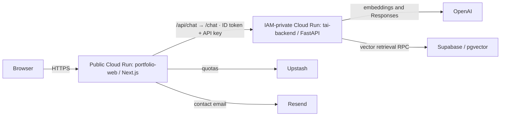

# Tudor Iacob — AI engineering portfolio

**[Live Website →](https://tudoriacob.cloud.run)**

A portfolio presenting Tudor Iacob's work in AI engineering and Python, with three project detail pages and **T AI**, a conversational RAG assistant. T AI retrieves public portfolio evidence, streams its answers, and displays source references. The production platform is **Google Cloud Run**, with a public Next.js service and an IAM-authenticated FastAPI service.

**Status: Live / Production — Google Cloud Run.** Hosted on Google Cloud Run in `europe-west1`: `portfolio-web` is the public Next.js service; `tai-backend` is the private FastAPI service protected by IAM.

Confirmed working in production: the Next.js frontend, T.AI conversational assistant, OpenAI generation, Supabase RAG retrieval, NDJSON streaming, and the Resend contact form with confirmed email delivery. Status updated 23 October 2026 from the project owner's production verification.

The visual system uses dark neutrals, a restrained green accent, accessible controls, and reduced-motion support. Existing public source documents are preserved. Supplemental knowledge is explicitly allowlisted; renaming a document does not automatically add it to the index.

## Technology stack

- Next.js 16, React, TypeScript, Node.js 24.22.1 or newer in the 24.x line, pnpm.
- Python 3.13, FastAPI, Uvicorn, HTTPX, Pydantic.
- OpenAI Responses API and embeddings; Supabase PostgreSQL with pgvector.
- Upstash Redis for distributed quotas; Resend for contact delivery.
- Multi-stage Docker builds, Cloud Run service identities, Google ID tokens, Secret Manager.

## What works without credentials

- All portfolio sections, project pages, anchor navigation, mobile menu, metadata, generated social image, sitemap and favicon.
- T AI **Portfolio preview**: deterministic excerpts from shared public content with source links. It is explicitly labelled and does **not** call an LLM or perform vector retrieval.
- Contact-form UI and validation. Actual email delivery requires Resend and Redis credentials.

Live RAG is working in production. See [the production audit](PRODUCTION_AUDIT.md) for the historical 6 October audit, fixes, and evidence; its pre-deployment status is superseded by the production confirmation above. The [Google Cloud Run deployment guide](GOOGLE_CLOUD_RUN_DEPLOYMENT.md) is the primary deployment reference.

## Architecture



The website is mostly rendered by React server components. Client boundaries handle navigation, contact interaction and chat state, receiving only the public data they need. The browser calls only same-origin routes; provider and database credentials stay on the server.

| Directory / file                        | Purpose                                                                 |
| --------------------------------------- | ----------------------------------------------------------------------- |
| `app/`                                  | Next.js pages, API routes, metadata and design tokens                   |
| `app/projects/[slug]/page.tsx`          | Generated individual project pages                                      |
| `components/`                           | Navigation, server-rendered cards, contact form and chat                |
| `components/tai/`                       | Chat container, input, messages and sources                             |
| `data/portfolio.json`                   | Main editable public content, shared with ingestion                     |
| `data/portfolio.ts`                     | TypeScript content types                                                |
| `lib/chat.ts`                           | Typed streaming protocol parser                                         |
| `lib/demo.ts`                           | Clearly labelled offline portfolio preview                              |
| `lib/analytics.ts`                      | Optional event-name-only analytics hook                                 |
| `backend/app/`                          | FastAPI, validation, limits, RAG pipeline and provider/store interfaces |
| `backend/ingestion/`                    | Public loaders, paragraph-aware chunking and indexing CLI               |
| `backend/tests/`                        | Backend and RAG regression checks                                       |
| `supabase/migrations/001_portfolio.sql` | Vector table, search and atomic reindex RPCs                            |
| `knowledge/`                            | Original public source documents                                        |

## Local development

Use patched Node.js 24.22.1 (or newer 24.x) and Python 3.13. This workspace uses **pnpm**, with a committed lockfile. Use pnpm 11.25.0 (or a compatible version) for reproducible installs.

```sh
pnpm install --frozen-lockfile
cp .env.example .env.local
pnpm dev
```

Open http://localhost:3000. On Windows, use `Copy-Item .env.example .env.local` instead of `cp` if preferred. If pnpm is not installed, install it using the package manager supported by your Node installation. On the original Codex machine, the bundled runtime can be invoked directly:

```powershell
$runtime = Join-Path $env:USERPROFILE '.cache/codex-runtimes/codex-primary-runtime/dependencies/node'
$env:PATH = (Join-Path $runtime 'bin') + ';' + $env:PATH
pnpm dev
```

Backend (PowerShell, from the repository root):

```powershell
python -m venv .venv
.\.venv\Scripts\python.exe -m pip install -r backend/requirements.lock.txt
Copy-Item backend/.env.example backend/.env
cd backend
..\.venv\Scripts\python.exe -m uvicorn app.main:app --reload --host 127.0.0.1 --port 8000 --no-access-log
```

On macOS/Linux activate `.venv/bin/activate`, install `backend/requirements.txt`, then run `uvicorn app.main:app --reload --port 8000 --no-access-log` from `backend/`. The lock snapshot was generated on Windows; `requirements.txt` is the portable dependency specification. `/health` reports process health and mode; it does not certify provider/database connectivity. Interactive API documentation is at `/docs` in demo mode.

Keep `BACKEND_URL` empty for the frontend portfolio preview. If you connect a backend in `MODE=demo`, it returns a clearly labelled fallback rather than invoking AI. For real RAG follow the live setup below.

## Environment configuration

### Frontend: local `.env.local`

| Variable                   | Purpose                                                                           |
| -------------------------- | --------------------------------------------------------------------------------- |
| `SITE_URL`                 | Canonical HTTPS origin in production, without a trailing slash                    |
| `BACKEND_URL`              | FastAPI origin; empty enables local portfolio preview                             |
| `BACKEND_API_KEY`          | Shared secret matching the backend; never `NEXT_PUBLIC_*`                         |
| `RESEND_API_KEY`           | Server-only Resend sending key                                                    |
| `CONTACT_EMAIL_FROM`       | Sender address on a verified Resend domain                                        |
| `CONTACT_EMAIL_TO`         | Recipient, e.g. `tudor.iacob@gmail.com`                                           |
| `UPSTASH_REDIS_REST_URL`   | HTTPS URL for shared contact rate limiting                                        |
| `UPSTASH_REDIS_REST_TOKEN` | Server-only Redis REST token                                                      |
| `TRUSTED_CLIENT_IP_HEADER` | Optional single-IP header overwritten by a trusted gateway; leave empty otherwise |

The contact form sends through Resend and fails closed if delivery or shared rate limiting is unavailable. See [contact setup and testing](CONTACT_SETUP.md). Do not commit `.env.local` or `backend/.env`.

### Backend: `backend/.env` / hosting environment

| Variable                | Default / requirement                                                  |
| ----------------------- | ---------------------------------------------------------------------- |
| `MODE`                  | `demo`; set `live` after setup                                         |
| `BACKEND_API_KEY`       | Required for live mode; use a strong random shared secret              |
| `LLM_API_KEY`           | Required in live mode                                                  |
| `LLM_BASE_URL`          | `https://api.openai.com/v1`; must support Responses and embeddings     |
| `LLM_MODEL`             | `gpt-6-luna`; configurable generation model available to your account  |
| `LLM_REASONING_EFFORT`  | `none` (default); optional `low` only after quality/latency evaluation |
| `EMBEDDING_MODEL`       | `text-embedding-3-small`                                               |
| `EMBEDDING_DIMENSIONS`  | `1536`, enforced to match the SQL schema                               |
| `SUPABASE_URL`          | Supabase project origin                                                |
| `SUPABASE_SECRET_KEY`   | Server-only `sb_secret_...` API key; required in live mode             |
| `CORS_ORIGINS`          | JSON array, e.g. `["https://your-domain.example"]`                     |
| `TOP_K`                 | `5`, maximum `10`                                                      |
| `SIMILARITY_THRESHOLD`  | `0.35`; calibrate against real portfolio questions                     |
| `RATE_LIMIT_PER_MINUTE` | `60` per backend peer address/process; secondary safety guard                                  |

Only the provider adapter knows the compatible API format. Implement the `Embeddings` and `Generator` protocols to use another vendor; implement `VectorStore` to change storage. Changing embedding models requires rebuilding all vectors; changing dimensions additionally requires a schema migration.

FastAPI and ingestion both read `SUPABASE_SECRET_KEY` through the shared backend settings. Keep it in `backend/.env` or the backend host's secret store, never in browser code or a `NEXT_PUBLIC_*` variable. A configured key must have the `sb_secret_` prefix and a nonempty suffix, with no whitespace; this checks its format, not whether Supabase accepts it. Live mode also requires a nonempty key. Ingestion explicitly selects live settings, even if `MODE=demo`, so it has the same credential requirements. Its `--dry-run` does not load credentials.

The REST/RPC adapter sends the key only in the `apikey` header. It does not send an `Authorization` header to Supabase: this application has no separately authenticated Supabase user JWT. The LLM provider and Resend SDK retain their own, unrelated authentication.

To migrate an existing deployment, replace the old environment-variable name with `SUPABASE_SECRET_KEY` and supply an actual secret API key from Supabase, rather than renaming a JWT credential. Restart the backend and use the updated environment for ingestion. No database migration or vector reindex is needed solely for this API-key change. No credentials are included in the example files.

## Supabase and live RAG setup

1. Create a Supabase project and run `supabase/migrations/001_portfolio.sql` in its SQL editor. The migration installs pgvector in the `extensions` schema.
   If the project used the earlier version of that migration and ingestion reports `DELETE requires a WHERE clause`, also apply `supabase/migrations/002_safe_index_replacement.sql`. It adds the required explicit predicate without changing the index-replacement transaction or privileges.
2. The vector table has row-level security and no anonymous/authenticated access. Both RPCs are executable only by the PostgreSQL `service_role` role. Supabase secret API keys resolve to that role and bypass RLS for privileged server requests; RLS remains enabled on the table. The existing grants remain valid. See the official [Supabase API-key documentation](https://supabase.com/docs/guides/getting-started/api-keys). Never expose the secret key to the browser.
3. Fill the backend environment. Set `MODE=live`. Startup validation rejects missing live credentials.
4. From `backend/`, run the ingestion commands below.
5. Start FastAPI. Set frontend `BACKEND_URL` and its matching `BACKEND_API_KEY`, then restart Next.js.
6. Ask known questions and check source links, unknown-fact fallbacks, timeouts and provider quota behavior before publishing.

## Content and knowledge-base updates

Edit `data/portfolio.json`:

- `profile`: name, professional positioning, biography, email and social links.
- `experience`: visible experience and education timeline. Keep detailed supplemental knowledge documents aligned when facts change.
- `skills`: category titles and technology lists.
- `projects`: slug, descriptions, technologies, highlights, category, `featured`, image and optional repository/demo/case-study URLs. Use unique stable slugs. Local images belong in `public/`; remote images require a matching Next.js image configuration.
- `services`: titles, descriptions and focus areas.
- `certifications`: confirmed title, issuer, year, credential URL and status. Leave unknown values null.
- `navigation` and `questions`: anchor navigation and suggested prompts.

The website and ingestion share this JSON. Ingestion also loads the original detailed experience, education, company-profiling and document-analysis markdown files, explicitly listed in `backend/ingestion/loaders.py`. Their YAML frontmatter must contain `public: true`. Other original files remain reference material and are deliberately not indexed, preventing duplicated or conflicting credentials. To add a supplemental document, include it in that loader's allowlist and provide a real section/project URL.

Project supplements merge into their canonical project document. Project and technology overview documents are generated from the same JSON to support broad questions. The current dry run produces 20 documents and 23 chunks. Malformed front matter, empty documents, duplicate IDs and indexed `[ADD ...]` placeholders fail validation.

Existing databases must also apply `supabase/migrations/003_reject_null_index.sql` to reject null index replacement safely. See the audit for Dashboard instructions; this migration has not yet been applied by the audit.

The supplied sources name the machine-learning course differently ("Supervised Machine Learning" versus "Machine Learning Specialization"). The shared data therefore says **Machine learning coursework**, pending confirmation. This takes precedence over the original certifications file.

### Reindexing

From `backend/` with the environment configured:

```sh
python -m ingestion.ingest --dry-run
python -m ingestion.ingest
```

For the Windows virtual environment use `..\.venv\Scripts\python.exe` in place of `python`.

The loader normalizes public documents; the chunker respects headings and paragraphs and bounds oversized paragraphs. Chunks retain stable content-based IDs, titles, categories, sections, projects, URLs, source and update timestamps. Embeddings are generated in batches. Only after all embedding requests succeed does one database transaction replace the complete portfolio index, removing obsolete chunks without exposing a partially rebuilt index. This command replaces **all records in the dedicated portfolio table**; do not share it with unrelated applications. Redeploy the frontend after JSON edits so both surfaces stay aligned.

## T AI behavior, security and privacy

- Generation uses `POST /v1/responses` with `LLM_MODEL`, `reasoning.effort=none`, `max_output_tokens=800`, streaming and `store=false`. Sampling parameters are omitted. The provider converts text/refusal deltas into the existing `token` events; it requires a successful completion event and rejects incomplete, malformed, interrupted or failed responses. It never switches to a fallback model. Existing API error sanitization remains in place.
- Embeddings remain `text-embedding-3-small` with 1536 dimensions via `/v1/embeddings`. A generation-model change requires no re-ingestion or Supabase migration.

- Simple English/Romanian greetings and small talk return immediately without model or retrieval calls. Other recognized social messages skip retrieval and use the model for language-aware replies.
- Obvious unrelated questions receive fixed, localized portfolio redirects without model or retrieval calls. Explicit portfolio questions use the existing multilingual embeddings and top-k retrieval. Ambiguous questions, contextual follow-ups and unanchored business inquiries receive a bounded semantic scope check before retrieval; invalid classification fails closed to a scope redirect. See [scope routing and acceptance results](SCOPE_CONTROL.md).
- Empty retrieval still allows hypothetical solution discussion, with an explicit no-evidence instruction prohibiting claims about Tudor's capabilities or experience. Missing personal facts must be acknowledged in the visitor's language.
- Generation receives up to six history messages, capped at 1,500 characters each, as untrusted JSON context. Only user turns may influence retrieval; assistant history cannot establish professional facts. Short follow-ups include recent user requirements. Language follows the current message, with context for ambiguous replies.
- A small RO/EN language-hint module reinforces clear messages and explicit language switches. Other languages remain model-detected; it does not classify intent. Real-model acceptance checks are still needed for language coverage and subtle factual attribution.
- The central prompt prohibits invented professional facts, business guarantees and instruction disclosure. Retrieved data and history are treated as untrusted. Prompt constraints reduce risk but are not a proof against all prompt injection or hallucination; no private data belongs in the index.
- Sources appear only when retrieval occurred and at least one valid source exists. They are evidence provided to the model, not an independently verified claim-by-claim attribution. English/Romanian greetings offer four clickable suggested questions.
- NDJSON events: `sources`, `token`, `done`, or `error`. The UI detects malformed events, missing completion, network failures, rate limits and interruption.
- Assistant responses render through react-markdown with raw HTML and images disabled and an explicit URL allowlist; user messages remain plain text. Source URLs are restricted to internal portfolio/project paths; sources without a safe URL render as unlinked titles. No HTML from the model is executed. See [T AI interface validation](TAI_UI_REPORT.md) for the additive UI action contract, accessibility changes and remaining limitations.
- Body-size, message-length and history limits, backend shared-secret authentication, explicit CORS, safe errors and request timeouts are implemented.
- T AI visitor quotas are **distributed through Upstash Redis** at Next.js. FastAPI retains a process-local per-peer safety guard. On Cloud Run, Redis failures fail closed with HTTP 503; other hosts retain the documented backend safety fallback. Configure provider spending limits and monitor outages. Do not trust arbitrary forwarded headers outside your managed gateway. Backend peer limits aggregate requests from the same frontend egress address.
- Conversation state lives in browser memory. Neither service persists complete conversations by default. Live requests send the question, recent history and retrieved public evidence to the configured AI provider; review that provider's retention settings. Hosting infrastructure may retain request metadata.
- Optional analytics dispatch only named `portfolio:analytics` browser events; no external analytics are installed and questions are never event payloads. Attach your own listener in `lib/analytics.ts` if needed.

## Validation

```sh
pnpm lint
pnpm typecheck
pnpm build
node --test scripts/test-chat.mjs
cd backend
python -m pytest -q
python -m compileall -q app ingestion
python -m ingestion.ingest --dry-run
```

Tests cover multilingual social routing, evidence-free generation, bounded untrusted history, requirement follow-ups, safe sources, public loaders, bounded/stable chunks, authentication, validation, body limits, rate limits and sanitized failures. Streaming parser tests cover split frames, invalid source events, interrupted responses and HTTP errors. These tests use doubles; they do not certify real model behavior.

Optional live acceptance check (with both local servers running): from `backend`, run `..\.venv\Scripts\python.exe tests/live_conversation_eval.py`. This uses configured paid APIs and prints synthetic conversations for human review: Romanian/English greetings, clinic inquiries, multi-turn requirements, language switching, French portfolio answers, unsupported claims, contact guidance and deliberately empty retrieval. Model outputs are probabilistic; inspect wording and attribution as well as completion status. No lead is submitted or stored by this flow.

## Deployment

See [Security remediation and verification](SECURITY_REMEDIATION.md) for the
reviewed dependency patches, regression results, remaining proxy-trust limitation,
and controlled redeployment/rollback procedure. Repository changes require a
manual Cloud Run release; GitHub security checks do not deploy production.

### Production Deployment — Google Cloud Run

The canonical production website is **[https://tudoriacob.cloud.run](https://tudoriacob.cloud.run)**.

| Service | Runtime | Production access |
| --- | --- | --- |
| `portfolio-web` | Next.js 16 | Public HTTPS frontend |
| `tai-backend` | Python / FastAPI | Private backend protected by Google Cloud IAM |

Both Docker services are deployed on Google Cloud Run in `europe-west1`.
Frontend-to-backend requests use Google Cloud IAM service-to-service
authentication with an additional backend API key. OpenAI powers generation,
Supabase with pgvector provides RAG retrieval, Resend delivers contact emails,
and Upstash Redis provides rate limiting.

See the primary [Google Cloud Run deployment guide](GOOGLE_CLOUD_RUN_DEPLOYMENT.md) for Cloud
Shell commands, separate environment inventories, secret permissions, billing
controls, memory acceptance, IAM checks, rollback, and independent RAG ingestion.

Both services run in `europe-west1`. The runbook recommends request-based billing,
minimum zero and maximum one instance per service, with a proposed 512 MiB memory
allocation. Production functionality confirmation does not establish memory or
load-test results. The $5/month total target is not guaranteed by
these settings; Cloud Run spend caps and project alerts are configured manually.

Next.js uses the backend's canonical `BACKEND_URL` as the ID-token audience.
Google's attached service identity and the existing shared API key protect calls;
no service-account key file is used. Secret Manager supplies only the secrets each
service needs. Runtime `SITE_URL` controls canonical metadata, robots, and sitemap.
Public API routes and the browser UI are unchanged.

Build from the repository root:

```sh
docker build -t portfolio-web -f Dockerfile .
docker build -t tai-backend -f backend/Dockerfile backend
```

The backend build context is **`backend/`**. Both containers run non-root, listen
on `0.0.0.0:$PORT` (default 8080), and exclude local secrets. Cloud Run refuses demo
backend startup. Local preview/demo remains available without Google credentials.

For future releases, repeat acceptance checks: unauthorized backend requests fail, real chat returns
`mode: live` with relevant citations, cancelled streams stop, quota errors are
handled, contact delivery succeeds, and metadata uses the actual HTTPS origin.
On Cloud Run, conservative shared Redis quotas remain in effect until proxy trust
is verified; Redis failures fail closed. No uptime pings or deployment triggers.

### Alternative: Vercel Services

[Vercel deployment](VERCEL_DEPLOYMENT.md) remains available as an alternative.
The existing `TAI_BACKEND_URL` binding is preserved outside Cloud Run. Vercel's
configuration is not used by the Cloud Run Docker builds.
## Remaining content and next improvements

- Confirm the machine-learning course title; add credential URLs and dates for both entries.
- Add public repositories, real screenshots, demos and deeper case studies when available. Current visual diagrams are illustrations, not screenshots of claimed products.
- Calibrate retrieval using a small set of answerable/unanswerable questions, then test prompt-injection cases against the chosen model.
- Verify deployed proxy trust for the existing shared rate limiter, operational metrics without chat text, and spending alerts as ongoing production checks.
- Run Lighthouse on the deployed domain and screen-reader checks. No Lighthouse score is claimed here.

The modular content and App Router structure supports future `/projects`, `/services`, `/about` and `/blog` pages without replacing the existing application.

## Implementation references

The compatible provider adapter follows the official [embedding guide](https://developers.openai.com/api/docs/guides/embeddings) and [Chat Completions reference](https://developers.openai.com/api/reference/resources/chat/subresources/completions/methods/create). The default embedding schema uses 1536 dimensions. Runtime API access still depends on your provider configuration.

### Distributed T AI rate limiting

Next.js uses the existing Upstash database for authoritative visitor limits: `TAI_RATE_LIMIT_PER_MINUTE=15` and `TAI_RATE_LIMIT_PER_DAY=100`. Contact and chat quotas are independent. FastAPI retains a broader, in-memory safety guard. See [T AI rate limiting](TAI_RATE_LIMITING.md) for trusted proxies, failure behavior and validation.
